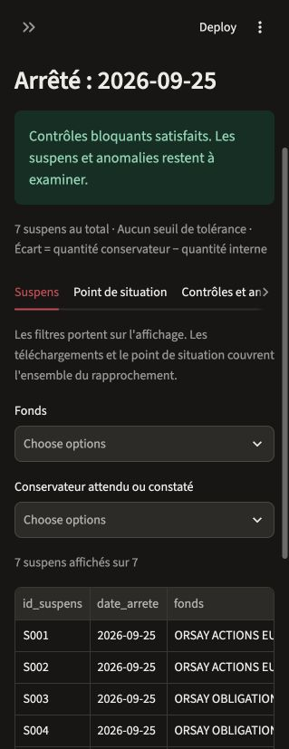
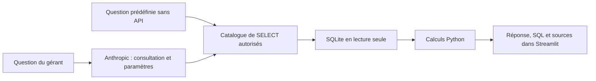
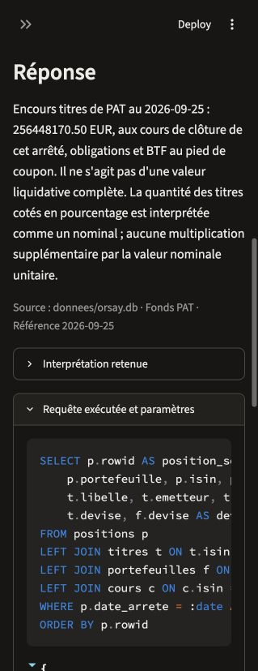

# Orsay Gestion — Assistant middle office

Application réalisée pour le cas pratique Saify : **rapprocher les positions chaque matin** et **répondre aux questions des gérants à partir de la base de gestion**.

Le projet utilise Python 3.12, Streamlit, pandas et openpyxl. Les calculs sont exécutés par Python ; Anthropic intervient uniquement pour interpréter les questions du second besoin. Les fichiers bruts restent inchangés.

## Lancer le projet

Prérequis : **uv** et les fichiers fournis dans `donnees/`. Ce dossier et `.env` restent locaux, exclus de Git : ils sont à récupérer séparément sur un autre poste.

```sh
uv sync
uv run streamlit run app/streamlit_app.py
```

Ouvrir l'adresse affichée dans le terminal, généralement [localhost:8501](http://localhost:8501). La navigation latérale donne accès aux deux pages.

Pour le langage naturel, renseigner `ANTHROPIC_API_KEY` dans le fichier `.env` à la racine. La clé n'est jamais à commiter. Le modèle par défaut est `claude-haiku-4-5`, modifiable avec `ANTHROPIC_MODEL`.

**Le rapprochement et les questions prédéfinies fonctionnent sans clé API.**

## Besoin 1 — Rapprocher les positions

L'opérateur dépose son inventaire interne et les relevés des trois conservateurs. L'application compare les quantités par **fonds + ISIN + conservateur**, puis indique les problèmes à traiter et les actions attendues.

### Entrées

| Fichier | Rôle |
|---|---|
| `positions_internes.csv` | Inventaire PMS : référence interne du rapprochement |
| `depositaire_A_20260925.xlsx` | Relevé du conservateur A, Excel |
| `depositaire_B_20260925.txt` | Relevé du conservateur B, largeur fixe |
| `depositaire_C_20260925.xml` | Relevé du conservateur C, XML |
| `parametrage.xlsx` | Correspondances comptes/fonds, types de suspens et actions |

### Architecture


La logique est répartie entre `src/lecture.py`, `src/preparation.py`, `src/rapprochement.py` et `src/exports.py`. L'interface se trouve dans `app/streamlit_app.py`. Les transformations se font en mémoire ; les références aux lignes sources sont conservées.

### Sorties

| Résultat affiché | Téléchargement |
|---|---|
| Tableau des suspens : fonds, ISIN, conservateur, quantités, écart, type, action et sources | `suspens.csv` |
| Point de situation prêt à transmettre au responsable | `point_situation.md` |
| Contrôles, anomalies et exclusions avec leurs motifs | `controles.csv` |

Les CSV utilisent UTF-8 avec BOM et le séparateur `;`. Les filtres portent sur l'affichage ; les exports contiennent le rapprochement complet.

**Utilisation :** charger les cinq fichiers dans le panneau latéral, puis cliquer sur **Lancer le rapprochement**. Sur le jeu fourni au 25/09/2026 : **7 suspens et 3 exclusions visibles**, sans contrôle bloquant en échec.



## Besoin 2 — Répondre aux gérants

Le gérant pose une question ou choisit une consultation prédéfinie. L'application lit **`donnees/orsay.db`** et affiche une réponse dont chaque chiffre peut être rapproché des données sources. Cette base ne sert jamais de référence au rapprochement du besoin 1.

### Architecture



`src/assistant.py` interprète la question avec Anthropic. `src/base.py` exécute une requête prédéfinie et paramétrée, puis calcule la réponse. `app/pages/assistant_gerants.py` fournit l'interface. Aucun SQL libre ni montant n'est généré par le modèle.

### Entrées et sorties

- **Entrées :** une question, le fonds et les dates de référence ; la base `orsay.db` ; la clé Anthropic uniquement en mode langage naturel.
- **Sorties :** réponse chiffrée, interprétation retenue, SELECT exécuté, paramètres, résultat brut et détail des calculs avec identifiants sources.
- **Consultations disponibles :** encours titres, concentration par émetteur, échéances de principal, opérations en attente et mouvements candidats d'un suspens.

**Utilisation :** ouvrir **assistant gerants** dans la navigation. Choisir le mode, saisir par exemple **« Quel est l'encours valorisé d'Orsay Patrimoine ? »**, puis cliquer sur **Obtenir la réponse**. Pour essayer sans API, choisir **Questions prédéfinies — sans API**.



## Choix et interprétations

- Code métier séparé de l'interface, fonctions simples et calculs déterministes avec `Decimal`.
- Aucun seuil de tolérance. Écart = quantité conservateur − quantité interne.
- P3G, sous-comptes absents et annulations C exclus et signalés. Une ligne sans sous-compte est non bloquante ; un compte inconnu ou une quantité illisible invalide le résultat.
- Une livraison chez le mauvais conservateur compte pour un seul suspens lorsque l'appariement est unique. Les cas ambigus restent séparés pour examen.
- Dates incohérentes : aucune comparaison. Le format ISIN est contrôlé, sans correction ni validation de sa clé.
- Pour la valorisation : nominal × cours / 100 si cotation en pourcentage, quantité × cours si cotation unitaire. L'encours titres n'est pas une valeur liquidative complète.

## Vérifications et limites

**Exécuté par l'assistant :** 60 tests réussis sur le besoin 1 avant l'ajout du besoin 2, dont l'intégration Streamlit avec les vrais fichiers et les exports. Pour le besoin 2 : vérification directe des cinq consultations, du mode sans API et d'un parcours complet Streamlit → appel réel Anthropic → SQLite → réponse. L'encours PAT obtenu est **256 448 170,50 EUR** au 25/09/2026. Les fichiers bruts et la base sont restés inchangés.

**Validation humaine :** à compléter lors de la démonstration ; aucune vérification manuelle par l'humain n'est déclarée ici. Le besoin 2 a été livré comme MVP, sans nouvelle suite pytest, conformément à la priorité donnée au délai.

Le MVP traite un fonds par question et la photographie du **25/09/2026**. Les demandes hors catalogue sont refusées. Les mouvements peuvent fournir des éléments explicatifs, sans prouver la cause d'un suspens. Il n'y a pas d'historique persistant ni d'envoi automatique au responsable. Les formats d'entrée suivent l'énoncé fourni.

Commandes utiles depuis la racine :

```sh
uv run python src/lecture.py          # afficher le CSV interne
uv run python src/rapprochement.py    # afficher le rapprochement et la synthèse
uv run pytest -q                     # exécuter la suite existante
```

Le découpage détaillé se trouve dans [plan.md](plan.md) et les consignes dans [AGENTS.md](AGENTS.md).
